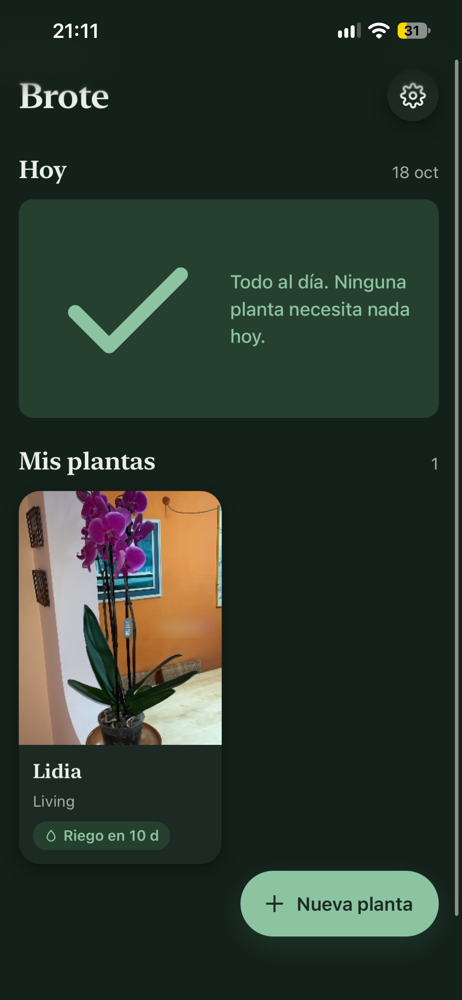
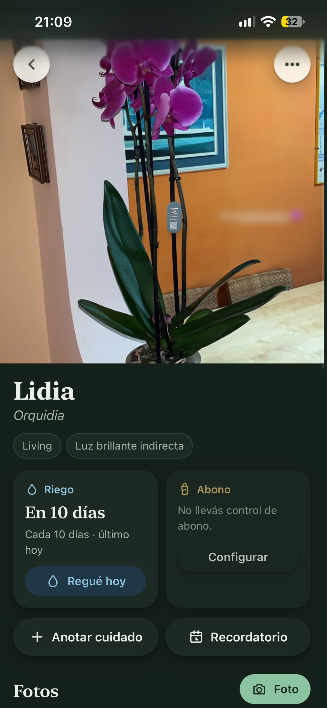
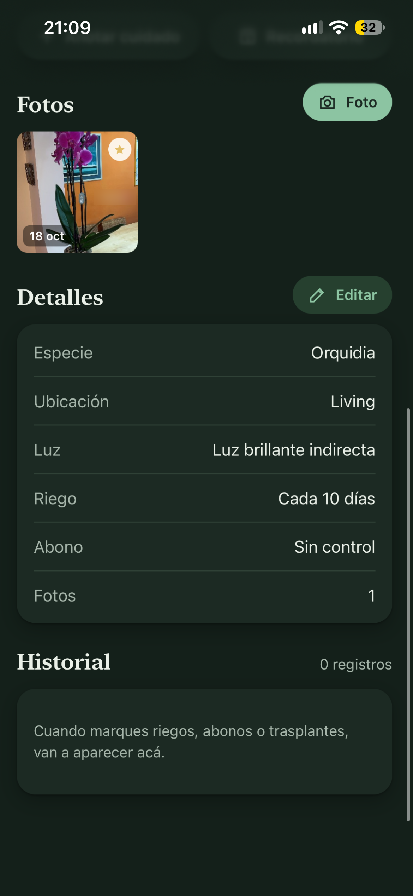

# Brote 🌱

App gratuita para llevar el cuidado de las plantas de tu casa.

**Abrir la app:** https://facundosarina.github.io/brote/

## Cómo se ve

  
  
  

🎬 [Ver el video de demostración](capturas/brote-demo.mp4)

## Qué hace
- Una ficha por planta: especie, ubicación, luz, notas.
- Riego y abono con frecuencia en días; la pantalla de inicio muestra qué toca hoy.
- Fotos con fecha, línea de tiempo y comparación (lado a lado o con deslizador).
- Recordatorios en el Calendario del teléfono.
- Copia de seguridad para exportar e importar.

## Cómo instalarla en el iPhone
1. Abrí el link en **Safari**.
2. Tocá **Compartir**.
3. Elegí **Agregar a inicio**.

Los datos se guardan solo en el teléfono de cada persona. No hay cuentas ni servidores.
